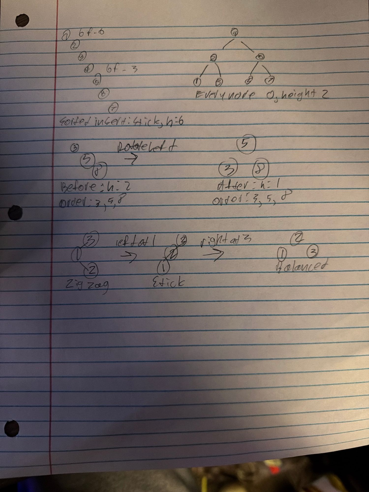

# Floor 9½ Lab Notes — The Hand on the Level

## 1. The transcript

Demo sequence, pasted from the terminal (`selftest balance`, `balance`,
`benchmark balance`, `quit`). Hero name entered at the prompt: Gary.

```
> selftest balance
  balanceFactor: empty==0, bushy==0, left-leaning==1: OK
  isBalanced: bushy {5,3,8,2,4,7,9} balanced (true): OK
  degenerate: sorted stick {1..6} is NOT balanced (height 5): OK
  rotate: rotateRootLeft on {1,2,3} -> root 2, height 1, order kept: OK
  balanceRoot: right- and left-heavy sticks both rebalance (order kept): OK
  all phases OK
> balance
  McCown's catalogue: 15 names, height 6, root balance factor -3 — NOT balanced (lopsided).
> benchmark balance

-- Same sorted input: your plain BST vs std::set (1000 iterations per cell) --
  N=     10  plain BST: height=     9  find=    0.128 us    std::set: find=   0.034 us
  N=    100  plain BST: height=    99  find=    1.204 us    std::set: find=   0.065 us
  N=   1000  plain BST: height=   999  find=   11.892 us    std::set: find=   0.098 us

Same data, same order. Inserted in sorted order, your plain BST
degenerated into a stick of height N-1 — lookup is back to O(n).
std::set saw the identical input and stayed shallow: it is a
balanced tree (a red-black tree) that rotates on every insert to
hold its height near log2 N. You do not hand-write that balancing —
you reach for std::set / std::map. That is the next floor, the
Hall of Names.

> quit
McCown notes your departure. "You leave in order."
```

## 2. The lean, by hand

Handwritten work for items 2, 3 and 4 (one page): top, the sorted-insert stick
with balance factors beside the balanced tree rooted at 4; middle, the left
rotation at 3 with the in-order walk before and after; bottom, the zig-zag
fixed by a left rotation then a right rotation.

A: The stick is taller, so find has to walk further down it, while the balanced tree only has height 2 compared to the stick’s 6, so there are fewer levels to go through and find costs less.



TODO: On paper, insert `1,2,3,4,5,6,7` into an empty BST in that order. Draw
the stick. Write the balance factor at the root and at one middle node. Then
draw the balanced tree on the same seven values (root 4). One sentence: same
values, same rule — what is different, and why does it change the cost of
`find`?

## 3. A rotation, by hand

(Drawing: middle of the handwritten page above.)

TODO: Take the leaning triple `3 -> (right) 5 -> (right) 8`. Perform a left
rotation at `3`. Draw the result and write the in-order walk before and
after. Confirm they match. One sentence: why does "in-order unchanged"
guarantee the result is still a valid BST?

A: A BST is valid as long as its in-order walk comes out sorted, so since the walk was still 3, 5, 8 after the rotation, every node still has smaller values on its left and bigger ones on its right.

## 4. Which rotation?

(Zig-zag drawing: bottom of the handwritten page above.)

TODO: For each unbalanced root, name the single rotation `rebalanceAt` would
apply and why: (a) a left-heavy root (balance factor +2); (b) a right-heavy
root (-2). Then describe (no code needed) the one case a single rotation
can't fix (the zig-zag), and what a real AVL does instead.


(a) +2: rotate right at the root, so the taller left child moves up.

(b) −2: rotate left at the root, so the taller right child moves up (like 3, 5, 8).

Zig-zag: When the root leans one way and its child leans the other, one rotation just flips the bend. AVL does a double rotation instead: left at 1 to make a stick, then right at 3, which gives a balanced tree

## 5. The comparison

The `benchmark balance` table is pasted in section 1 above. For reference, the
same table:

```
  N=     10  plain BST: height=     9  find=    0.128 us    std::set: find=   0.034 us
  N=    100  plain BST: height=    99  find=    1.204 us    std::set: find=   0.065 us
  N=   1000  plain BST: height=   999  find=   11.892 us    std::set: find=   0.098 us
```

TODO: In two sentences: the plain BST and the `std::set` saw the identical
sorted input. Why did one become a stick and the other stay shallow? What is
`std::set` doing on every insert that your BST is not?

The plain BST only adds a new node at the bottom of the existing path, so sorted input always goes to the far right and grows a stick of height N−1, which is why its find time scales roughly 10× each time N does. std::set is a red-black tree: after every insert it checks the balance rules along the path and fixes any violation with recolors and rotations, keeping its height around log₂ N

## 6. Reflection

TODO: One paragraph. You stopped one step short of a self-balancing tree on
purpose. Was that the right call? When would you implement balancing yourself
instead of using `std::set` / `std::map`, if ever? And: you have now built
five pointer structures and are about to start using one. What changes when
the data structure is a black box you trust?

A: Yeah stopping before the full self-balancing tree was fine. I get how rotations work now and why they keep the order the same, but actually writing a full AVL or red-black tree with all the insert and delete cases would mostly be tracking edge cases, and std::set already does it and is way faster, like the benchmark showed. I’d only write my own balancing if std::set/std::map can’t do what I need. An example of that would be like needing extra stuff stored in each node. The big change with using a black box is I’m not checking the tree’s rules myself anymore. I just trust that it’s O(log n) and keeps things sorted. Knowing how it works inside still helps though, because then I know when it’s the wrong tool

## AI acknowledgment

Claude Sonnet 5.5 (Anthropic, 2026) was used to build the project and run the
demo commands (`selftest balance`, `balance`, `benchmark balance`) in a
properly configured build environment, and to paste the raw terminal output
into this file. The code and all analysis (every TODO above) are my own.
